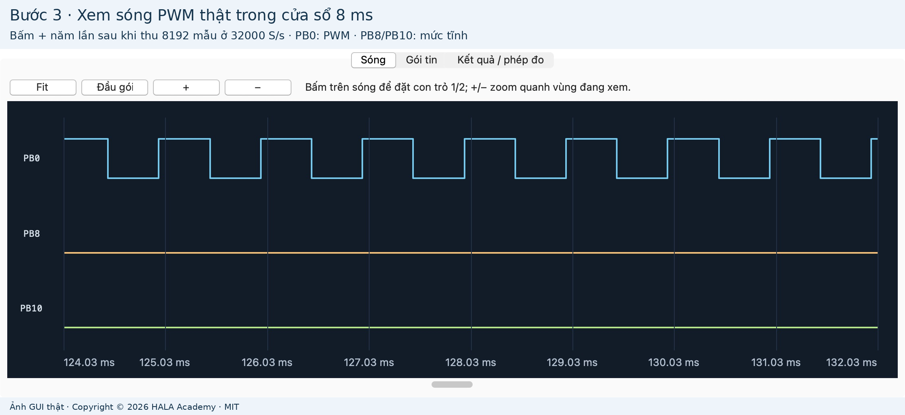
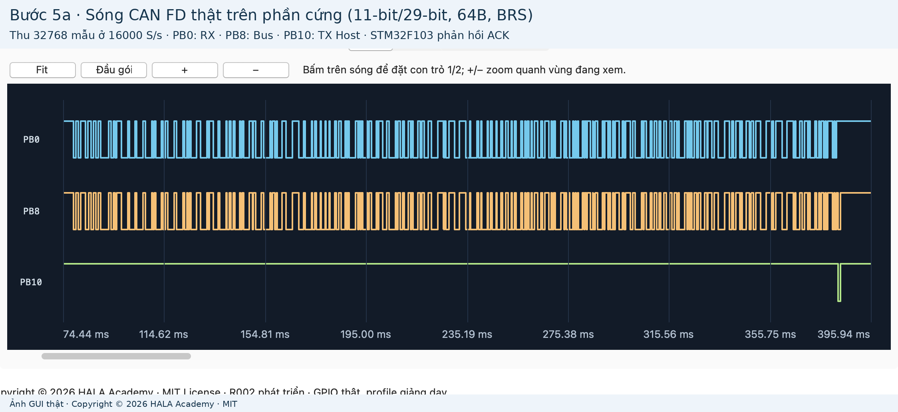
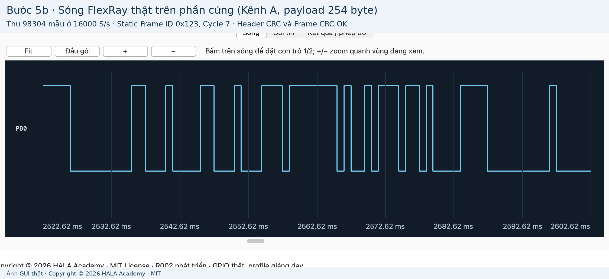
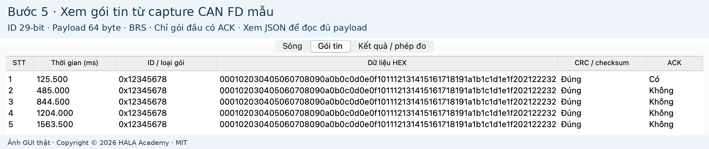

# HALA Logic · Logic Analyzer & Protocol Lab

[](https://github.com/HalaAcademy/hala-logic/actions/workflows/ci.yml)
[](LICENSE)
[]()
[-orange.svg)]()
[]()

Copyright © 2026 HALA Academy · [MIT License](LICENSE).
Kho lưu trữ chính thức: [https://github.com/HalaAcademy/hala-logic](https://github.com/HalaAcademy/hala-logic).

**HALA Logic** là giải pháp phần cứng và phần mềm mã nguồn mở biến bo mạch vi điều khiển giá rẻ **STM32F103 (Blue Pill)** thành một máy phân tích logic (Logic Analyzer) và bộ thu/phát mô phỏng các giao thức truyền thông nhúng & ô tô: **GPIO/PWM, UART, LIN, Classical CAN, CAN FD và FlexRay**.

Công cụ được thiết kế phục vụ học tập, nghiên cứu và giảng dạy embedded automotive với giao diện trực quan làm việc trực tiếp qua **USB/CDC Serial**, hỗ trợ đo đạc tham số xung thời gian thực và giải mã gói tin chi tiết theo tiêu chuẩn công nghiệp.

---

## 1. Hình ảnh thực tế từ phần cứng

Tất cả hình ảnh dưới đây được chụp trực tiếp từ giao diện HALA Logic khi kết nối và chạy kiểm thử trên bo mạch phần cứng STM32F103 thật:

### Sóng PWM 1 kHz và phép đo thời gian thực
Bắt tín hiệu PWM, đo tự động tần số, chu kỳ xung (period), độ rộng xung mức cao/thấp (pulse width) và duty cycle:


### Sóng CAN FD 64-byte payload có bit rate switch (BRS) và ACK từ STM32
Host phát frame CAN FD, firmware STM32 trên phần cứng nhận dạng đúng và kéo bit ACK phản hồi:


### Sóng FlexRay Kênh A với Static Frame 254 byte payload
Phân tích khung truyền FlexRay kép (Dual Channel A/B), chuỗi TSS, Header CRC (11-bit) và Frame CRC (24-bit):


### Bảng giải mã gói tin chi tiết
Hiển thị danh sách gói tin, thời gian timestamp, ID, cờ điều khiển, payload HEX và trạng thái kiểm tra CRC/ACK:


---

## 2. Ma trận giao thức hỗ trợ

| Giao thức | Tính năng & Khả năng | Tốc độ / Tần số lấy mẫu | Ví dụ firmware kiểm thử |
|---|---|---|---|
| **GPIO / PWM** | Bắt sóng đa kênh, đo tần số, chu kỳ xung, pulse width, duty cycle, đặt con trỏ thời gian Δt | Lấy mẫu Streaming tới 32 kHz, độ phân giải 31.25 µs | [`examples/gpio/pwm`](examples/gpio/pwm) |
| **UART** | Chuẩn 8N1, baud tùy biến, gửi/nhận HEX, kiểm tra bit Start/Stop, hiển thị ASCII/HEX | Baud 1000..115200 bit/s, lấy mẫu ≥ 4 mẫu/bit | [`examples/uart/transmit`](examples/uart/transmit) |
| **LIN** | Master/Slave mode, Header (Break + Sync + PID), Response 0..8 byte, Classic & Enhanced Checksum | Lấy mẫu Streaming 32 kHz, decode chân bus | [`examples/lin/transmit`](examples/lin/transmit) |
| **Classical CAN** | CAN 2.0A (11-bit) & 2.0B (29-bit), Data Frame 0..8 byte, Remote Frame (RTR), CRC 15-bit | Nominal baud 1000..10000 bit/s (profile giáo dục) | [`examples/can/transmit`](examples/can/transmit) |
| **CAN FD** | ISO CAN FD, 11-bit & 29-bit ID, payload 0..64 byte, BRS (Bit Rate Switch) 2 Mbps, CRC 17/21-bit | Data baud = 2× Nominal, lấy mẫu Streaming 16..32 kHz | [`examples/canfd/transmit`](examples/canfd/transmit) |
| **FlexRay** | Dual-channel Kênh A & B, Static Frames, payload 0..254 byte, Frame ID 1..2047, Cycle 0..63 | Header CRC (11-bit), Frame CRC (24-bit), lấy mẫu 16 kHz | [`examples/flexray/transmit_channel_a`](examples/flexray/transmit_channel_a) |

---

## 3. Sơ đồ chân kết nối phần cứng

Mạch đo sử dụng cơ chế nội suy và kích thích logic thông qua các chân GPIOB của STM32F103:

| Chân STM32 | Chức năng | Mô tả kết nối |
|---|---|---|
| **PB0** | **DUT / Tín hiệu đo** | Tín hiệu từ vi điều khiển hoặc thiết bị cần phân tích (ví dụ: ngõ ra PWM hoặc chân TX của DUT) |
| **PB8** | **Logic Bus / RX** | Đường bus logic dùng để thu thập mẫu và giải mã dữ liệu trên máy tính |
| **PB10** | **Host TX / Kích thích** | Ngõ ra phát tín hiệu từ Host máy tính khi dùng tính năng "Gửi gói và thu" |
| **GND** | **Mass chung** | Nối chung mass (GND) giữa bo mạch Blue Pill và hệ thống cần đo |
| **USB** | **Giao tiếp PC** | Cáp Micro-USB kết nối trực tiếp với máy tính (nhận diện Virtual COM Port / CDC Serial) |
| **SWD** | **Nạp / Debug** | Chân SWDIO, SWCLK, GND nối với ST-Link V2 khi nạp firmware monitor hoặc debug |

---

## 4. Bắt đầu nhanh

### Bước 1: Cài đặt môi trường

Xem hướng dẫn chi tiết theo hệ điều hành: [Windows](docs/CAI_DAT_WINDOWS.md), [macOS](docs/CAI_DAT_MACOS.md) hoặc [Linux](docs/CAI_DAT_LINUX.md).

```sh
git clone https://github.com/HalaAcademy/hala-logic.git
cd hala-logic

# Cài đặt thư viện Python
python -m pip install -r requirements.txt
```

### Bước 2: Khởi chạy giao diện HALA Logic

```sh
python tools/lab.py gui
```

1. Cắm cáp USB bo mạch Blue Pill vào máy tính.
2. Bấm **Làm mới**, chọn cổng COM (Windows) hoặc `/dev/cu.usbmodem...` (macOS) rồi bấm **Kết nối**.
3. Chọn giao thức cần phân tích, bấm **Bắt đầu thu** (để đo tín hiệu ngoài) hoặc **Gửi gói và thu** (để phát frame và đo phản hồi).

### Bước 3: Xem dữ liệu đo thật ngoại tuyến (không cần cắm bo mạch)

Bạn có thể trải nghiệm xem dạng sóng và phân tích gói tin thật ngay lập tức bằng dữ liệu mẫu đi kèm:

```sh
# Xem sóng PWM 1 kHz
python tools/lab.py gui --open examples/captures/pwm.json

# Xem sóng và gói tin CAN FD 64-byte payload có ACK
python tools/lab.py gui --open examples/captures/canfd-tx.json

# Xem sóng và khung truyền FlexRay 254-byte payload
python tools/lab.py gui --open examples/captures/flexray-a.json
```

---

## 5. Biên dịch, nạp firmware và kiểm thử

### Kiểm tra công cụ & biên dịch

```sh
# Kiểm tra môi trường phát triển (ARM GCC, OpenOCD, Python)
python tools/lab.py doctor

# Biên dịch firmware monitor và toàn bộ 19 ví dụ
python tools/lab.py build
```

### Nạp firmware lên STM32 qua OpenOCD / ST-Link V2

```sh
# Cài đặt firmware monitor (chỉ cần làm lần đầu tiên hoặc khi cập nhật monitor)
python tools/lab.py install-monitor

# Nạp một ví dụ giao tiếp cụ thể
python tools/lab.py flash pwm           # Ví dụ phát xung PWM
python tools/lab.py flash canfd-tx      # Ví dụ nhận CAN FD và gửi ACK
python tools/lab.py flash flexray-tx-a  # Ví dụ nhận FlexRay Kênh A
```

### Chạy kiểm thử tự động

```sh
# Chạy 59 bài kiểm thử đơn vị độc lập
python tools/lab.py test

# Kiểm tra tính toàn vẹn kho lưu trữ, link tài liệu và ảnh provenance
python tools/check_repo.py

# Kiểm thử tự động trên phần cứng thật (kèm xác minh bộ đệm RAM qua GDB/SWD)
python tests/hardware/advanced_tx_acceptance.py
```

---

## 6. Cấu trúc kho lưu trữ

```text
hala-logic/
├── firmware/       Mã nguồn USB CDC, Timer/DMA sampling, startup và linker của monitor
├── host/           Giao diện đồ họa (GUI), USB client, engine giải mã protocol và phép đo
├── examples/       19 ví dụ giao tiếp C độc lập (mỗi bài có mã nguồn, Makefile và README)
├── tools/          Bộ công cụ quản lý build, flash, kiểm tra kho và đóng gói phát hành
├── tests/          Bộ kiểm thử đơn vị (unit tests) và kiểm thử phần cứng thật (hardware tests)
├── configs/        Cấu hình USB VID:PID, OpenOCD và danh mục ví dụ
├── docs/           Tài liệu hướng dẫn chi tiết, hình ảnh chụp thực tế và kiến trúc kỹ thuật
└── LICENSE         Giấy phép mã nguồn mở MIT
```

Xem chi tiết tại [Cây thư mục và quy ước tổ chức](docs/CAU_TRUC.md).

---

## 7. Tài liệu chuyên sâu

- [Hướng dẫn từng bước có ảnh minh họa](docs/BAT_DAU.md)
- [Cấu hình thu/phát và hướng dẫn sử dụng công cụ](docs/SU_DUNG_TOOL.md)
- [Quy trình nạp bằng OpenOCD và debug GDB](docs/NAP_VA_DEBUG.md)
- [Báo cáo rà soát và tiêu chuẩn xuất bản Git](docs/REVIEW_GIT.md)
- [Bản ghi nguồn gốc và mã băm SHA256 của ảnh](docs/images/provenance.json)
- [Kế hoạch thực thi và lộ trình phát triển](docs/technical/MASTER_EXECUTION_PLAN_R002.md)

---

## 8. Đóng góp và giấy phép

Dự án được phát hành theo giấy phép **[MIT License](LICENSE)**. Mọi đóng góp từ cộng đồng đều được hoan nghênh:

- Xem [Quy chuẩn đóng góp](CONTRIBUTING.md) để biết thêm thông tin về phong cách mã nguồn và quy trình gửi Pull Request.
- Lịch sử thay đổi được ghi nhận tại [Nhật ký phiên bản](CHANGELOG.md).
- Thông báo về các thành phần bên thứ ba tại [Thông báo bản quyền](THIRD_PARTY_NOTICES.md).
