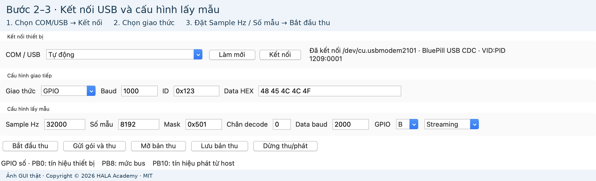
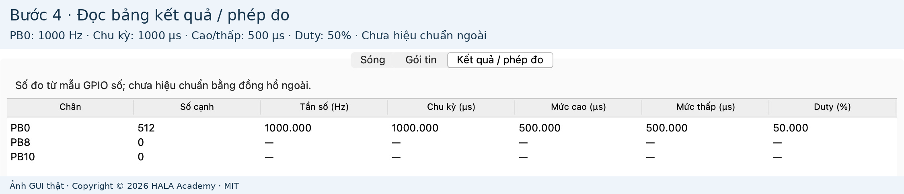

# Bắt đầu với HALA Logic

Copyright © 2026 HALA Academy · MIT.

Hướng dẫn này dành cho người dùng tool. Thiết bị cần được cài monitor và chương trình tạo/nhận tín hiệu trước. Người phát triển thực hiện [nạp lần đầu bằng OpenOCD](NAP_VA_DEBUG.md); thao tác đó nằm ngoài HALA Logic.

## Bước 1 — Cài và mở tool

Chọn hướng dẫn [Windows](CAI_DAT_WINDOWS.md), [macOS](CAI_DAT_MACOS.md) hoặc [Linux](CAI_DAT_LINUX.md). Sau khi tạo/kích hoạt môi trường Python, chạy tại thư mục có README.md:

```sh
python -m pip install -r requirements.txt
python tools/lab.py gui
```

Chưa có board vẫn có thể xem dữ liệu thật được lưu sẵn:

```sh
python tools/lab.py gui --open examples/captures/pwm.json
```

## Bước 2 — Chọn COM/USB và kết nối

Cắm USB Blue Pill bằng cáp có truyền dữ liệu. Bấm **Làm mới**, chọn COM trên Windows, `/dev/cu.usbmodem...` trên macOS hoặc `/dev/ttyACM...` trên Linux. Có thể chọn **Tự động** nếu chỉ có một thiết bị tương thích. Bấm **Kết nối**; trạng thái phải báo cổng, mô tả USB và VID:PID.



## Bước 3 — Thu sóng PWM đầu tiên

Với chương trình PWM đang chạy trên thiết bị, đặt:

| Trường trên tool | Giá trị |
|---|---|
| Giao thức | GPIO |
| GPIO | B |
| Mask | `0x501` |
| Chân decode | `0` (không dùng giải mã trong mode GPIO) |
| Sample Hz | `32000` |
| Số mẫu | `8192` |
| Mode | Streaming |

Bấm **Bắt đầu thu**. Sau khi có dữ liệu, bấm **+** năm lần để xem cửa sổ 8 ms, thấy rõ xung 1 kHz. **Fit** quay lại toàn bản thu; thanh cuộn dịch vùng đang xem.


GPIO B là GPIOB vật lý của STM32. Mask `0x501` chọn PB0, PB8, PB10. Với mẫu này PB0 phát PWM, PB8/PB10 giữ mức tĩnh. Tín hiệu khác cần mask/chân/baud phù hợp chương trình thực tế.

## Bước 4 — Đọc phép đo và dùng con trỏ

Chọn **Kết quả / phép đo**. Mẫu PWM hiển thị PB0: 1000 Hz, chu kỳ 1000 µs, mức cao/thấp 500 µs, duty 50%. PB8/PB10 không có cạnh nên các phép đo chu kỳ hiện `—`.



Trong tab Sóng, bấm hai điểm để đặt con trỏ 1/2 và đọc Δt; bấm lần thứ ba bắt đầu cặp mới. Ở 32000 S/s, độ phân giải là 31,25 µs/mẫu. Các giá trị dùng clock MCU, chưa hiệu chuẩn bằng đồng hồ ngoài.

## Bước 5 — Gửi frame hoặc mở gói mẫu

Nếu thiết bị đang chạy chương trình UART nhận: chọn **UART**, Baud `1000`, Data HEX `48 45 4C 4C 4F`. Đặt Streaming, `32000` S/s, `8192` mẫu. Chân decode `8` đọc bus RX hoặc `0` đọc phản hồi. Bấm **Gửi gói và thu**. Chương trình nhận phải dùng cùng tốc độ; chọn giao thức không làm thay đổi chương trình thiết bị.

Với LIN/CAN/CAN FD/FlexRay, xem [bảng mode và giới hạn](SU_DUNG_TOOL.md). Để học cách đọc bảng gói mà không thay chương trình thiết bị, dùng **Mở bản thu** với `examples/captures/canfd-ext-tx.json`, rồi chọn **Gói tin**:


Ảnh này là bản thu CAN FD lịch sử, không phải một lần phát CAN FD mới. Chỉ gói đầu có ACK; CRC đúng không đồng nghĩa chương trình nhận đã xử lý đúng. Chọn hàng để xem đủ payload và các trường kiểm tra trong JSON chi tiết.

## Bước 6 — Lưu và mở lại

Bấm **Lưu bản thu**, chọn tên JSON. Tool chép các file hiện có cùng tên gốc: JSON, BIN, CSV, VCD, PNG. Giữ JSON/BIN cùng nhau để kiểm SHA256 và mở lại; capture mẫu phân phối chỉ có JSON/BIN nên không tự sinh CSV/VCD/PNG khi chép.

PNG xuất dữ liệu là đồ thị từ mẫu; ảnh trong hướng dẫn là screenshot GUI thật. Ảnh công khai đã cắt thanh tiêu đề/điều khiển môi trường, không sửa hình sóng hoặc kết quả. [Nguồn gốc và SHA256 ảnh](images/provenance.json).
