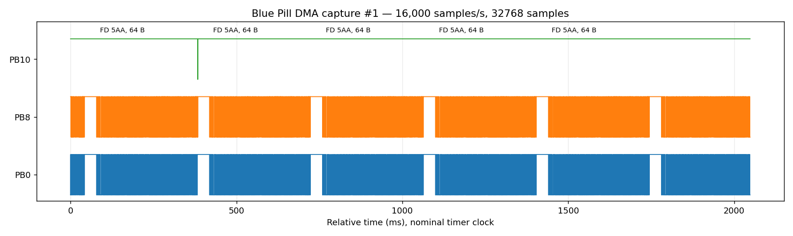
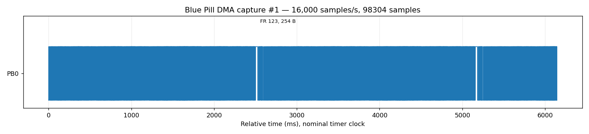

# Sử dụng HALA Logic

## Kết nối

Chọn COM/USB rồi Kết nối. Tool mở cổng khi thực hiện tác vụ, đóng sau tác vụ để thuận tiện dùng công cụ khác; không mở hai tác vụ board cùng lúc. macOS hiện đường dẫn USB serial/mô tả/VID:PID. Windows dùng COM. Không có chức năng nạp/debug trong GUI.

## Lấy mẫu

| Trường | Ý nghĩa |
|---|---|
| Sample Hz | Tần số lấy mẫu GPIO, khác baud giao thức |
| Số mẫu | Streaming: bội 1024, tối đa 1048576; Burst: tối đa 2048 |
| Mask | Bitmask chọn chân, ví dụ `0x501` = PB0/PB8/PB10 |
| Chân decode | Số bit GPIO dùng giải mã; phải có trong mask |
| GPIO port | A/B/C là tên port vật lý của STM32 |
| Streaming / Burst | Đọc nhiều block qua USB hoặc chụp một buffer SRAM |
| Data baud | Bit rate pha data của CAN FD |

GPIO chỉ hiện sóng. UART/LIN cần ≥ 4 mẫu/bit; CAN/FD/FlexRay cần ≥ 8 mẫu/bit cho decoder hiện tại. FD 1000 → 2000 bit/s dùng 16000 S/s và ít nhất 32768 mẫu cho frame 64 byte. FlexRay payload 254 byte cần cửa sổ dài, ví dụ 98304 mẫu ở 16000 S/s. Mức lấy mẫu vượt tốc độ host có thể INVALID/lost; giữ lỗi, giảm rate và thử lại.

Khi đổi giao thức, tool đặt lại tần số/số mẫu mặc định phù hợp; chỉnh các trường sau khi chọn giao thức. CAN FD/FlexRay dùng cửa sổ dài hơn.

## Gửi frame

| Giao thức | Cấu hình |
|---|---|
| UART | 8N1, data HEX |
| LIN | ID 0..63, data 0..8 byte hoặc Chỉ gửi LIN header; số byte response dùng cho decoder |
| CAN | ID 11/29-bit, DATA 0..8 byte hoặc RTR với DLC 0..8 |
| CAN FD | ID 11/29-bit, payload 0..8/12/16/20/24/32/48/64 byte, BRS tùy chọn; không RTR |
| FlexRay | Static frame, channel A/B riêng, ID 1..2047, cycle 0..63, payload chẵn 0..254 byte |

Nhập HEX như `DE AD BE EF`, không `0x` trước từng byte. Baud có thể thay đổi trong giới hạn thiết bị; chương trình bên thiết bị phải dùng đúng tốc độ. Bộ phát FD hiện hỗ trợ BRS data=2×nominal; chưa hỗ trợ tỷ lệ khác. LIN không bị khóa vào bảng ID của một ví dụ; chương trình nhận quyết định ID nào được xử lý.

Fixture phát hiện tại cố định PB10 host, PB8 bus/RX và PB0 tín hiệu thiết bị, chỉ GPIOB; không cần jumper loopback. UART/FlexRay dùng relay một nguồn, CAN/FD/LIN dùng resolver AND. RAM/DMA tạo lịch phát và lấy mẫu, chương trình vẫn đọc IDR thật. Đây là mức logic giáo dục, không phải transceiver CAN/LIN/FlexRay vật lý chuẩn điện áp.

Gửi gói và thu hiện dùng Streaming, không tự sinh peer ACK khi chỉ thu nguồn ngoài. Không có reactive scheduler/cluster tổng quát. Cửa sổ phải đủ dài cho toàn gói; tool từ chối trước khi phát nếu quá ngắn.

## Xem sóng và kết quả

Fit hiển thị toàn capture, Đầu gói hiện 80 ms quanh gói đầu, +/− zoom, thanh cuộn di chuyển vùng. Bấm hai điểm đặt con trỏ 1/2, hiện Δt; bấm lần thứ ba bắt đầu cặp mới. Tab Gói tin có thời gian, ID/data, CRC/checksum/ACK, chọn hàng xem JSON chi tiết. Tab phép đo có edge count, frequency, period, pulse width, duty; không đủ dữ liệu thì hiện `—`.

CRC đúng chỉ nói về tín hiệu đã giải mã; xác nhận chương trình nhận đúng cần oracle/app state hoặc GDB của người phát triển. Không có đo analog/rise-time điện áp, auto baud, pretrigger/vô hạn hoặc toàn bộ mode trong ma trận.

## Kiểm thử phần cứng nâng cao và xác minh SWD/GDB

Để xác minh toàn diện cả hai chiều (Host phát logic, MCU nhận và giải mã trong SRAM thật):

```sh
python tests/hardware/advanced_tx_acceptance.py
```

Quy trình tự động thực hiện 4 ca kiểm thử trên STM32F103 qua ST-Link V2:
1. **CAN FD Standard (11-bit)**: Nạp `canfd-tx`, Host phát frame 64 byte payload với BRS (Nominal 1000 bit/s, Data 2000 bit/s), xác minh MCU kéo bit ACK và đọc đúng toàn bộ 64 byte trong RAM qua OpenOCD/GDB.
2. **CAN FD Extended (29-bit)**: Nạp `canfd-tx-ext`, Host phát frame 64 byte ID mở rộng `0x1234567`, xác minh ACK và tính toàn vẹn CRC 21-bit.
3. **FlexRay Kênh A**: Nạp `flexray-tx-a`, Host phát Static Frame 254 byte payload, kiểm tra Header CRC (11-bit) và Frame CRC (24-bit) trong bộ đệm nhận của MCU.
4. **FlexRay Kênh B**: Nạp `flexray-tx-b`, Host phát Static Frame 254 byte trên kênh thứ hai, xác minh độc lập kênh truyền.
5. **Khôi phục**: Tự động flash lại firmware mẫu `pwm` và khôi phục trạng thái an toàn.




